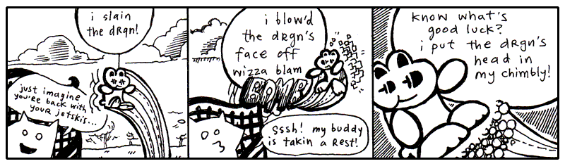
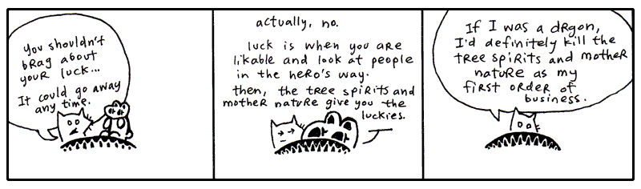
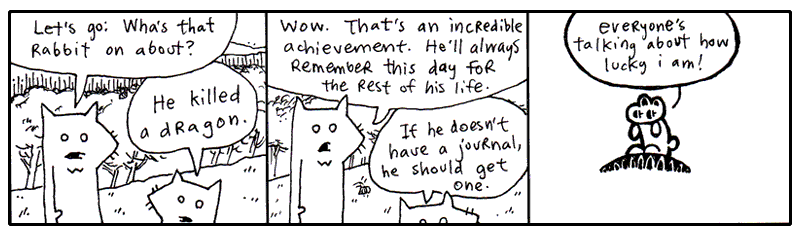
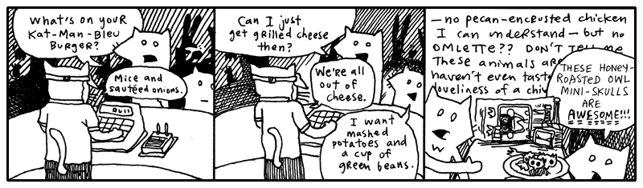
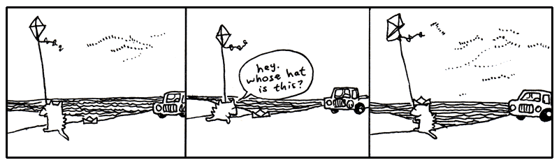
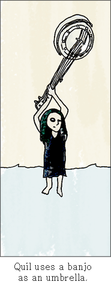
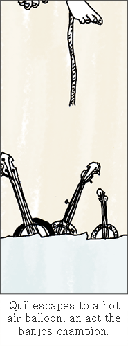
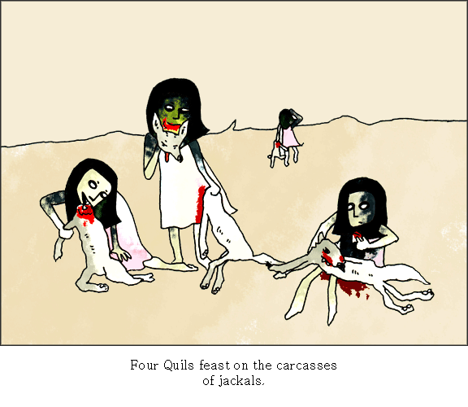

---
hide:
  - toc
---

# 6. A Sponsored Dragon-Slaying



[TOC]

“Look around,” said Fox Small. “Some of us don’t have time for quests. Some of
us have major responsibilities, jobs, so on. Livelihood, got it?”

“_Heyyyy_, my **<span class="caps">JOB</span>** was to kill the drgn!!” screamed
the wee rabbit, blinking his eyes and bouncing frantically from tree to tree to
pond to pond. 

!!! story ""
    “His snout was a **<span class="caps">HUGE</span>**
    responsibility!! His smoky breath was _mine to reckon with!!_ I spent fifty
    dollars on the cab **<span class="caps">JUST</span>** to get out there, which
    was another _huge huge_ ordeal. You have _nothing on me_, not a _single_
    indictment, my whole **<span class="caps">HERONESS</span>** is _absoflutely
    unimpeachable_, my whole **<span class="caps">APPROACH</span>** is _abassoonly
    unapricotable_, just ask Lester.”

    “Who’s Lester?” said the Fox Small.

    “Lester’s my cab driver! He parked at the base of Dwemthy’s Array!!” The rabbit
    ricocheted madly like a screensaver for a supercomputer. _“Just ask Dwemthy!!”_

    “Well,” said the Fox Small. He turned back to look up at Fox Tall, who was
    sitting straight and looking far into the distance. “Wait, they have a parking
    lot on Dwemthy’s Array?”

    **“YEP!!** And a pretzel stand!!”

    “But, it’s _an Array_? Do they sell churros?”

    **“CHOCOLAVA!!”** bleated the rabbit.

    “What about those glow-in-the-dark ropes that you can put in your hair? Or you
    can just hold them by your side or up in the air—”

    **“BRAIDQUEST!!”**

    “You should get a cut of the salesman’s commission,” spoke Fox Small. “Folks
    came out to see you kill the dragon, right?”

    **“BUT!!** I don’t operate the tongs that actually extract the chocolava.”

    “I’m just sayin’. You **do** operate the killing mechanism. So you _have a stake_
    in the ensalada.”

    “OH NO!! I left my favorite lettuce leaves in Dwemthy’s Array!!” squealed the
    rabbit, twirling like a celebratory saber through the quaking oak. Distantly:
    “Or Lester’s trunk, maybe?”

    “You know—Gheesh, can you stay put??” said Fox Small.

    “My radio,” said Fox Tall, stirring to life for a moment, “in my pickup.” The
    glaze still seeping from his eyes. His stare quivered and set back into his
    face, recalling another time and place. A drive out to Maryland. Sounds of
    Lionel Richie coming in so clearly. The wipers going a bit too fast. He pulls up
    to a house. His mother answers the door. She is a heavily fluffed fox. Tears and
    makeup.

    Slumping back down, “That porcupine is changing my presets.”

    The rabbit bounded up on to the armrest of the park bench and spoke closely.
    **“BUT!!** Soon I will feast on drgn’s head and the juices of drgn’s tongue!!”
    The rabbit sat still and held his paws kindly.

    “(Which I hope will taste like cinnamon bears,)” whispered the rabbit,
    intimately.

    “I love cinnamon,” said Fox Small. “I should go killing with you some time.”

    “You should,” said the rabbit and the eyes shine-shined.

    “Although, salivating over a tongue. You don’t salivate over it, do you?”

    “I DO!!” and the rabbit got so excited that Sticky Whip shot out of his eyes.
    (More on Sticky Whip in a later sidebar. Don’t let me forget. See also: _The
    Purist’s Compendium to Novelty Retinal Cremes_ by Jory Patrick Sobgoblin,
    available wherever animal attachment clips are sold.)

“Okay, you’ve hooked me. I want to hear all about it,” Fox Small declared.
“Please, talk freely about the chimbly. Oh, and Dwemthy. Who is he? What makes
him tick? Then maybe, if I’m still around after that, you can tell me about what
makes rabbits tick, and maybe you can hold our hands through this whole missing
truck ordeal. I need consolation more than anything else. I could probably use
religion right now. I could use your personal bravery and this sense of
accomplishment you exude. Do you smoke a pipe? Could be a handy tool to coax
along the pontification we must engage in.”

And the rabbit began expounding upon Dwemthy and the legend of Dwemthy and the
ways of Dwemthy. As with most stories of Dwemthy, the rabbit’s tales were mostly
embellishments. Smotchkkiss, there are delicacies which I alone must address.

Please, never ask who Dwemthy is. Obviously he is a mastermind and would never
disclose his location or true identity. He has sired dynasties. He has set
living ogres aflame. Horses everywhere smell him at all times. Most of all, he
knows carnal pleasures. And to think that this…

This is his Array.

## 1. Dwemthy’s Array


You stand at the entrance of Dwemthy’s Array. You are a rabbit who is about to
die. And deep at the end of the List is this preview of a monster class (we will define `Creature` before running it):

```py
class Dragon(Creature):
    _life = 1340       # tough scales
    _strength = 451    # bristling veins
    _charisma = 1020   # toothy smile
    _weapon = 939      # fire breath
```

As we have seen before, the underscore is a convention that tells users, *Keep your paws off this. It's an implementation detail.*

A scalding _<span class="caps">SEETHING LAVA</span>_ infiltrates the
**cacophonous <span class="caps">ENGORGED MINESHAFTS</span>** deep within the
ageless canopy of the _<span class="caps">DWEMTHY FOREST</span>_... chalky and
nocturnal screams from **the belly of the <span class="caps">RAVENOUS WILD
STORKUPINE</span>**... who eats **wet goslings** _<span class="caps">RIGHT
AFTER</span>_ they’ve had a few graham crackers and a midday nap… amidst starved
hippos _<span class="caps">TECHNICALLY ORPHANED</span>_ but truthfully sheltered
by umbrellas owned jointly by car dealership conglomerates… beneath _uncapped
vials_ of mildly pulpy **<span class="caps">BLUE ELIXIR</span>**... _which shall
remain… heretofore… **<span class="caps">UNDISTURBED</span>… <span
class="caps">DWEMTHY</span>!!!**_



_If you don’t understand Dwemthy’s Array, it is Dwemthy’s fault. He designed the
game to complicate our lives and were it simpler, it would not be the
awe-inspiring quest we’ve come to cherish in our arms this very hour._

Dwemthy’s Array has a winding history of great depth. It is not enough to simply
say, “Dwemthy’s Array,” over and over and expect to build credentials from that
act alone. Come with me, I can take you back a couple years, back to the sixties
where it all started with metaprogramming and the dolphins.

You might be inclined to think that **metaprogramming** is another hacker word
and was first overheard in private phone calls between fax machines. Honest to
God, I am here to tell you that it is stranger than that. For this story, our detour into metaprogramming begins
with _dolphins and an unusual use of the word_ (Lilly used the term for mental processes; that use should not be confused with the origin of metaprogramming in computer science).

In the sixties, a prolific scientist named John C. Lilly began experimenting
with his own senses, to uncover the workings of his body. I can relate to this.
I do this frequently when I am standing in the middle of a road holding a pie or
when I am hiding inside a cathedral. I pause to examine my self. This has proven
to be nigh impossible. I have filled three ruled pages with algebraic notation,
none of which has explained anything. The pie, incidentally, has been very easy
to express mathematically.

But the scientist Lilly went about his experiments otherwise. He ingested <span
class="caps">LSD</span> in the company of dolphins. Often in a dark, woeful
isolation tank full of warm salt water. Pretty bleak. But it was science! (This is a literary detour, not programming advice.)

**Drugs, dolphins and deprivation.** Which led to Lilly’s foray into things
meta. He wrote books on mental programming, comparing humans and computers. You
may choose to ingest any substance you want during this next quote—most likely
you're reaching for the grain of salt—but I assure you that there’s no Grateful
Dead show on the lawn and no ravers in the basement.

> When one learns to learn, one is making models, using symbols, analogizing,
> making metaphors, in short, inventing and using language, mathematics, art,
> politics, business, etc. At the critical brain (cortex) size, languages and
> its consequences appear. To avoid the necessity of repeating learning to
> learn, symbols, metaphors, models each time, I symbolize the underlying idea
> in these operations as metaprogramming.
>
> John C. Lilly, <em>Programming and Metaprogramming in the Human
> Biocomputer</em>, New York, 1972.

We learn. But first we learn to learn. We set up programming in our mind which is
the pathway to further programming. (Lilly is largely talking about programming
the brain and the nervous system, which he collectively called the
_biocomputer_.)

Lilly’s metaprogramming was more about feeding yourself imagery, reinventing
yourself, all that. This sort of thinking links directly to folks out there who
dabble in shamanism, wave their hands over tarot cards and wake up early for
karate class. I guess you could say metaprogramming is New Age, but it’s all
settled down recently into a sleeping bag with plain old nerdiness. (If you got
here from a Google search for “C++ Metaprogramming”, stick around, but I only
ask that you _burn_ those neural pathways that originally invoked the search.
Many thanks.)

Meta itself is spoken of no differently in your author’s present day.

> All sensuous response to reality is an interpretation of it. Beetles and
> monkeys clearly interpret their world, and act on the basis of what they see.
> Our physical senses are themselves organs of interpretation. What
> distinguishes us from our fellow animals is that we are able in turn to
> interpret these interpretations. In that sense, all human language is
> meta-language. It is a second-order reflection on the ‘language’ of our
> bodies—of our sensory apparatus.
>
> Terry Eagleton, <em>After Theory</em>, London, 2003, ch. 3.

To that end, you could say programming itself is a meta-language. _All code_
speaks the language of action, of a plan which hasn’t been played yet, but
shortly will. Stage directions for the players inside your machine. I’ve waxed
sentimental on this before.

But now we’re advancing our study, venturing into metaprogramming, but don’t
sweat it, **it’s still just the Python you’ve seen already**, which is why Dwemthy
feels no qualms thrusting it at you right away. Soon enough it will be as easy
to spot as addition or subtraction. At first it may seem intensely bright, like
you’ve stumbled across your first firefly, which has flown up in your face.
Then, it becomes just _a little bobbing light_ which makes living in Ohio so
much nicer.

<aside class="sidebar" markdown="1">
**Bread Riddles**

Question: Can one take five bites from a bread and make the shape of a bicycle?
Answer: Yes.

Question: Can one rip a bread in half and still fit the bread in an envelope?
Answer: Yes.

Question: Can one man take a bread and throw it while another man sits without
bread? Answer: Yes.

Question: Can four breads in a box be explained? Answer: Yes.

Question: Can a clerical error in my company books be attributed to bread?
Answer: Yes.

Question: Can dancers break through a scrim of bread? Answer: Yes.

Question: Can those same dancers, when faced with an inexplicably different
scrim of bread, fail to break through? Answer: Yes.

Question: Does bread understand my darkest fears and wildest dreams? Answer:
Yes.

Question: Does bread desire me? Answer: Yes.

Question: Will bread be invisible to robots? Answer: Yes.

Question: Can one robot take eight bites on a bread, without knowing it’s there,
and make the shape of a smaller bread? Answer: Yes.

Question: Should my clerics be equipped with bread? Answer: Yes.

Question: In relation to bread, will robots each have their own elephants?
Answer: Yes.

Question: Can one rip a bread in half and not let it ruin one’s game of
dominoes? Answer: Yes.

Question: Will we always love bread? Answer: Yes.

Question: Will we have more bread? Answer: Yes.

Question: Can four breads marry a robot’s elephant? Answer: Yes.
</aside>


### Eval, The Littlest Metaprogrammer

The following experiments belong in a scratch Python session. Start a fresh session for the saved game classes so experimental class redefinitions do not affect them.

We've spent some time building up objects using object-oriented programming. Classes have attributes and behavior, child classes inherit from their parents, and properties give us a clean interface to an object's attributes.

But Python has another trick up its sleeve.
**Metaprogramming** is *writing code which writes code*. **But the program doesn't jump onto your screen and wrench the keyboard from your hands.** It's much more civilized.

Python lets you execute code while your program is running using `eval()`.

The `eval()` function takes a string and asks Python to evaluate it as an expression.

For example:
```python
eval("1 + 2")
# 3
```

A string becomes code. Python reads it, understands it, and gives you the result. This is where things start getting a little interesting.

You can even tuck the name of an attribute into a string:
```python
class Dragon():
    _life = 1340       # tough scales
dragon = Dragon()
trait = "life"
eval(f"dragon._{trait}")
# 1340
```

I totally understand if you've come to this point and your eyes are spinning in their sockets and your knees have locked up. Just rub some tiger balm on your joints while I talk about `eval`.

For our purposes, the interesting part isn't that `eval()` can do simple math. It's that Python can take a description of code and turn that description into something executable. Python is taking our little strings and turning them into instructions. It's like handing a note to a very literal laboratory assistant:

"Please examine the dragon's life."

Your assistant squints at the note, turns it into Python code, and heads into the laboratory. This is a tiny taste of metaprogramming: writing code that works with code. But don't get too excited about handing `eval()` every mysterious scrap of paper you find. If the string comes from somewhere you don't trust, Python will happily evaluate whatever code is inside it. In other words, `eval()` is a powerful little creature. Keep it on a short leash.

The interactive interpreter displays the result of an expression when that result is not `None`. Assignments and other statements do not automatically display a result. It is a little conversation between you and Python, but not every line gets an answer.

You could write your own Python shell prompt very easily:

```python
print(">> ", end="")
result = eval(input())
print("=>", repr(result))
```

This is a one-shot expression evaluator, not a complete REPL: there is no loop, and `eval()` cannot execute statements such as assignments or `for` loops. Use it only with input you wrote and trust; it is not a sandbox. For an actual interactive session, use Python’s built-in shell. How do you like that? Two of your recently learned concepts have come together in a most flavorful way. The `eval()` takes the typed code and runs it. The response from `eval()` is then passed to `repr()`, which gives us the useful representation of the resulting object.

The interactive interpreter intends to spit out useful representation for programmers, and `repr()` does just that. When you're building a little interactive prompt like this, `repr()` is exactly what you want.


Suppose we have our Dragon and want to print a list of our dragon's traits:

```py
class Dragon():
    _life = 1340       # tough scales
    _strength = 451    # bristling veins
    _charisma = 1020   # toothy smile
    _weapon = 939      # fire breath

dragon = Dragon()  # an instance of this newly defined class
```

```python
traits = ["life", "strength", "charisma", "weapon"]
```

We could use `eval()`:
```python
for trait in traits:
    print(eval(f"dragon._{trait}")) #not recommended
```

Python gives you metaprogramming powers, but that doesn't mean you should use them for everything. Most of the time, **we do** write out classes and methods normally for readability. For example, using `eval()` like this is generally not recommended. If untrusted text reaches `eval()`, it can execute arbitrary code. Instead, we could use `getattr()` when you need an attribute whose name is stored in a string. `getattr()` performs attribute lookup rather than parsing Python source. It does not validate attribute names for you: use an explicit allowlist if callers must be restricted to certain attributes. Properties and custom lookup hooks can still run code during attribute access.

Instead of using `eval` to print all traits, we could have used `getattr`. 
```py
for trait in traits:
    print(getattr(dragon, f"_{trait}"))
```

Now that you've seen how Python can read an attribute whose name is stored in a string, it's time to peek at an even stranger trick. We could create a new `Creature` class **where each property is created** *dynamically*:

```python
class Creature:
    _magic = 10
def magic(self): return self._magic
setattr(Creature, "magic", property(magic))
```

That's a rather astonishing line that creates a new property to access a class variable on the fly. 

The above code is the equivalent to creating a getter property like this:  

```python
class Creature:
    _magic = 10
    @property
    def magic(self): # getter
        return self._magic
```

But it can be done at run-time, creating new properties for a dragon out of thin air. 

How does it work? We use `setattr(object, name, value)`. The `object` is `Creature` class, the `name` is `"magic"`, and the `value` is a `property(magic)`. When someone asks a creature for its `magic`, this new `setattr` code tells Python to reach inside the object and give back `_magic`.

As we have seen before this is called monkey patching as we are modifying a class at runtime, but it is also **metaprogramming** as we are writing code that modifies a program's structure at runtime. 

Let's go ahead and use the new property to access the creature's `_magic` class variable without having to use the `_`:

```pycon
>>> class Creature:
...     _magic = 10
...     _hair = 0   # hairless creature
...
>>> def magic(self):
...     return self._magic  # getter
...
>>> setattr(Creature, "magic", property(magic))
>>> creature = Creature()
>>> creature.magic
10
>>> def hair(self):
...     return self._hair  # getter
...
>>> setattr(Creature, "hair", property(hair))
>>> creature = Creature()
>>> creature.hair
0
```

Python is constructing part of a class for us (getter property methods) while the program is running. But why would we want to do this?

Imagine you have dozens of creature traits that you want to make into property attributes:

```text
_life
_strength
_charisma
_weapon
_speed
_armor
```

Writing the same `@property` over and over would become rather tedious. If all those properties follow the same pattern, Python can create them for us using a generic `lambda` function to replace the property function definitions, `getattr` to lookup the correct attribute, and a `for` loop to loop over the attributes and set each on:

=== "Multiple Properties"
    ```python
    def make_getter(name):
        return lambda self: getattr(self, f"_{name}")

    for trait in ["life", "hair", "strength", "charisma", "weapon", "speed", "armor"]:
        setattr(Creature, trait, property(make_getter(trait)))
    ```

=== "Single Property"
    ```python
    def magic(self): # getter
        return self._magic

    setattr(Creature, "magic", property(magic))
    ```

Now one small piece of code creates the property descriptors. Each corresponding backing attribute must still exist before you read a property; otherwise it raises `AttributeError`.

Each call to `make_getter(name)` creates a separate enclosing scope, so each returned lambda closes over its own `name`.

**That's when metaprogramming starts earning its keep.** We're no longer using a complicated trick to replace one simple property. We're using Python to handle a whole family of repetitive definitions.

The laboratory doors are beginning to creak open. And somewhere inside, something is learning how to program itself.


And with the case of our little spell to create a property on the fly: 
```python
class Creature:
    _magic = 10
def magic(self):return self._magic
setattr(Creature, "magic", property(magic))
```

The explicit version that creates a property is waaay easier to read:

```python
class Creature:
    _magic = 10

    @property
    def magic(self): # getter
        return self._magic
```

Anyone opening the file can immediately see what `magic` does (creates a getter property). But with `setattr()` version, they have to stop, squint at the machinery, and mentally unpack what the program is doing.

Remember, the Pythonic approach is generally to **use plain code** when it does the job. Reach for dynamic techniques ONLY when they actually make a problem simpler. Don't summon a Python wizard when a perfectly good carpenter is standing right there with a hammer. However, when you have a whole menagerie of creature traits, suddenly that wizard starts looking rather useful.

Store these little metaprogramming tricks away as we'll need to use them on our rabbit's path to glory. 

### Creature Code

Object-oriented programming is a way of organizing code around objects. Let's say it's more like **a little orange pill** you won at the circus. When you suck on it, the coating wears away and behind your teeth hatches a massive, floppy sponge brontosaurus. He slides down your tongue and leaps free, frolicking over the pastures, yelping, "Papa!" And from then on, whenever he freaks out and attacks a van, well, that van is sparkling clean afterwards.

Now, let's say _someone else_ puts their **little orange pill** under the faucet. Not on their tongue, _under the faucet_. And this triggers a different cataclysm, which births a set of wailing sponge sextuplets. **Umbilical cords and everything.** Still very handy for cleaning the van. But an altogether different kind of chamois. And, one day, these six will stir Papa to tears when they perform the violin concerto of their lives.

That's rather like what we're doing with classes. We put some common behavior and attributes into a class, and then use that class as a blueprint for creating objects.

The `Creature` class is our little orange pill. It contains the machinery that all our creatures can use.

Now, with a lateral slice across the diaphragm, we expose the innards of `Creature`.

```python
class Creature:
    def __init__(self, slogan=""):
        self.slogan = slogan
        self._life = type(self)._life
        self._strength = type(self)._strength
        self._charisma = type(self)._charisma
        self._weapon = type(self)._weapon

    @property
    def life(self):
        return self._life

    @property
    def strength(self):
        return self._strength

    @property
    def charisma(self):
        return self._charisma

    @property
    def weapon(self):
        return self._weapon

    @property
    def name(self):
        return self.__class__.__name__

    def __repr__(self):
        return f"<{self.name}(life={self.life})>"

```

The line below gives each creature instance its own starting life:

```python
self._life = type(self)._life
```

This code initializes an instance variable from a class default. We read the starting life from the creature’s class (`Rabbit`, `Dragon`, etc.) and store it on the individual instance. During combat, changes to `self._life` affect that creature, leaving the class default unchanged.

Python distinguishes class attributes from instance attributes. For these underscore-prefixed data attributes, an instance’s own value takes precedence over the class default with the same name.

Now, focus on the four properties being set up in `Creature`. These are the little windows through which we can inspect the creature's innards. The values themselves are class-level defaults (class variables) supplied by each creature subclass.

A `Dragon` is one of the creatures produced from that machinery. We can create a dragon by giving it its default values:

```python
class Dragon(Creature):
    _life = 1340       # tough scales
    _strength = 451    # bristling veins
    _charisma = 1020   # toothy smile
    _weapon = 939      # fire breath
```

Our `Dragon` class supplies the default values such as `_life`, but the instance keeps track of its own changing `_life`. 

We do the same for the other attributes `_strength`, `_charisma`, and `_weapon`, tying them to the instance. 

So when Python encounters:

```pycon
>>> my_dragon = Dragon()
>>> my_dragon.life
1340
>>> my_dragon.strength
451
```

The inherited getter properties spring into action and return the corresponding instance values from `my_dragon`.

It's almost as if Python sneaks into the laboratory after hours, rummages through a drawer of spare monster parts, bolts everything together, transplants a spiny green heart, and gives the creature a healthy jolt of electricity.

**POWER UP! POWER UP!**

The resulting dragon is remarkably compact:

```python
class Dragon(Creature):
    _life = 1340       # tough scales
    _strength = 451    # bristling veins
    _charisma = 1020   # toothy smile
    _weapon = 939      # fire breath
```

Yet it already knows how to expose its attributes via the properties and methods from `Creature`:

```pycon
>>> dragon = Dragon()
>>> dragon
<Dragon(life=1340)>
```

But how does the Dragon know what it is when the `__repr__` method is called from inside Creature??

This `__repr__()` uses runtime **introspection** for an object to find out what type of `Creature` it is. It reads the instance’s class name to provide a helpful representation e.g. `<Dragon(life=1340)>`. Proper representation isn’t usually a part of dealing with a monster. It’s something Dwemthy adds as a courtesy to our players at the bottom of the `Creature` class. 

Many call him twisted, many call him austere, but we’d all be ignorant to go without admiring the footwork Dwemthy puts in for us. 

```pycon
>>> print(dragon.life)
1340
```

And notice that we access `dragon.life`, not `dragon._life`. Again the underscore attributes are the creature's internal machinery and are a polite way of saying to users, "This is my internal machinery. Please don't poke it directly." 

The properties defined by `Creature` provide the clean public interface that we can use with the `Dragon` class:

```pycon
>>> print(dragon.strength)
451
>>> print(dragon.charisma)
1020
>>> print(dragon.weapon)
939
```

The dragon never defines those properties and methods itself. They are **inherited** from `Creature` just as a baby dragon inherits his mother's eyes. 

This is one of the pleasures of object-oriented programming. You teach a parent class a few tricks, and all of its descendants inherit them. One lesson, many monsters.

Our laboratory is beginning to look quite respectable.

Although there is still that matter of making the monsters **fight**.

### Enough Belittling Instruction and Sly Juxtaposition—Where Is Dwemthy’s Array??

We've now given our creatures attributes, inherited those attributes from a parent class, and taken our first peek behind the curtain at code that can write other code.

Tread carefully—here comes **the other half of DWEMTHY’S ARRAY!!**

Replace the preliminary `Creature` definition and **save this completed version in <a href="../code-examples/dwemthy.py" download>dwemthy.py</a>**. It includes the properties from before plus the battle methods and `DwemthysArray`.

```python title="dwemthy.py"
import random

class Creature:
    def __init__(self, slogan=""):
        self.slogan = slogan
        self._life = type(self)._life
        self._strength = type(self)._strength
        self._charisma = type(self)._charisma
        self._weapon = type(self)._weapon

    @property
    def life(self):
        return self._life

    @property
    def strength(self):
        return self._strength

    @property
    def charisma(self):
        return self._charisma

    @property
    def weapon(self):
        return self._weapon

    @property
    def name(self):
        return self.__class__.__name__

    def __repr__(self):
        return f"<{self.name}(life={self.life})>"

    # -- new methods --- 

    def __call__(self):
        if self.slogan:
            print(self.slogan)

    # This method applies a hit taken during a fight.
    def hit(self, damage):
        if self.life <= 0:
            return
        power_up = random.randint(0, self.charisma)

        if power_up % 9 == 7: 
            self._life += power_up // 4
            print(f"[{self.name} magick restores {power_up // 4} life points!]")

        self._life -= damage

        if self._life <= 0:
            print(f"[{self.name} has died.]")

    # This method takes one turn in a fight.
    def fight(self, enemy, weapon):
        if self.life <= 0:
            print(f"[{self.name} is too dead to fight!]")
            return

        # Attack the opponent
        your_hit = random.randrange(self.strength + weapon)

        print(f"[You hit with {your_hit} points of damage!]")
        enemy.hit(your_hit)

        # Retaliation
        print(enemy)

        if enemy.life > 0:
            enemy_hit = random.randrange(enemy.strength + enemy.weapon)

            print(f"[Your enemy hit with {enemy_hit} points of damage!]")
            self.hit(enemy_hit)

class DwemthysArray(list):
    def __getattr__(self, name):
        if not self: # empty list
            if name == "life":
                return 0
            raise AttributeError(name)

        monster = self[0]
        attr = getattr(monster, name)
        if not callable(attr):
            return attr

        def dynamic_access(*args, **kwargs):
            result = attr(*args, **kwargs)
            # The selected monster should still be in front of the list.
            assert self and self[0] is monster, "The attacking monster is gone!"
            if monster.life <= 0:
                self.pop(0)
                if self:
                    print("\n")
                    print(f"[Get ready. A wild {self[0].name} has emerged.]")
                else:
                    print("[Whoa. You decimated Dwemthy’s Array!]")
            return result
        return dynamic_access
```

This code adds a few new methods to `Creature`. The `hit` method reacts to a hit from another `Creature`. And the `fight` method lets you place your own blows against
that `Creature`.

When your `Creature` takes a hit, a bit of defense kicks in and your `charisma`
value is used to generate a power-up. Don't ask me to explain the secrets behind
this phenomenon. A random number is picked, some simple math is done, and, if
you're lucky, you get a couple of life points.

```python
self._life += power_up // 4
```
Integer division is performed using the floor division operator (`//`). It divides the numbers and rounds down to the nearest whole number (the floor).

Then, the enemy's blow is landed.

```python
self._life -= damage
```

That's how the `Creature.hit()` method works.

The `fight()` method checks to see if your `Creature` can attack. Next, a random hit is placed on your opponent. If your opponent lives through the hit, it gets a chance to strike back. Those are the workings of the `Creature.fight()` method.

I'll explain the rest of Dwemthy's Array in a second. I really will. I'm having fun doing it. Let's stick with hitting and fighting for now.

## 2. Rabid Objects that Communicate

### Introducing: You.

You may certainly tinker with derivations on this rabbit. But official Dwemthy Paradigms explicitly denote the code—and the altogether character—inscribed below.
**Save this as <a href="../code-examples/rabbit.py" download>rabbit.py</a>.**

```python title="rabbit.py"
import random
from dwemthy import Creature

class Rabbit(Creature):
    _life = 10
    _strength = 2
    _charisma = 84
    _weapon = 4
    def __init__(self, slogan=""):
        super().__init__(slogan)
        self.bombs = 3

    # little boomerang
    def __xor__(self, enemy):
        self.fight(enemy, 13)

    # the hero's sword is unlimited!!
    def __truediv__(self, enemy):
        weapon = random.randrange(
            4 + (enemy.life % 10) ** 2
        )
        self.fight(enemy, weapon)

    # Lettuce builds your strength and extra roughage flies in the face of your opponent!!
    # Like popeye and spinach but a bunny and lettuce
    def __mod__(self, enemy):
        lettuce = random.randint(0, self.charisma)

        print(f"[Healthy lettuce brings you {lettuce} life and strength points!!]")
        if self._life < 0:
            print("[Reviving with lettuce...]")
        self._life += lettuce
        self._strength += lettuce
        self._charisma += round(lettuce*.5)
        self.fight(enemy, 0)

    # bombs, but you only have three!!
    def __mul__(self, enemy):
        if self.bombs == 0:
            print("[UHN!! You're out of bombs!!]")
            return

        if self.life <= 0:
            print("[Rabbit is too dead to throw a bomb! Revive first with lettuce!!]")
            return
    
        self.bombs -= 1
        if enemy.name == "Dragon":
            print("[The bomb ignites the dragon's fire breath! BOOM!!]")
            enemy.hit(50000)
        else:
            self.fight(enemy, 86)
```

You have four weapons. The boomerang. The hero's sword. The lettuce. And the bombs.

Notice `super().__init__(slogan)`. This runs the `Creature`'s usual `__init__` on this rabbit, storing a `slogan` and starting stats as instance variables. Then `self.bombs = 3` adds the rabbit’s own supply of bombs. Without it only `Rabbit`'s `__init__` gets run.

Bomb carry extra power against fire breathers like a dragon that carries its own furnace. Throw a bomb into that fire breath and—well, Dwemthy really should have read the insurance exclusions. *Save a bomb for the dragon*: it deals 20,000 damage before the beast can strike back.

Now, let's use our rabbit! Open Python and import the classes we've created above.

```pycon
>>> from dwemthy import Creature, DwemthysArray
>>> from rabbit import Rabbit
```

Now, unroll yourself.

```pycon
>>> r = Rabbit("i blow'd the drgn's face off!!")
>>> r()
i blow'd the drgn's face off!!
>>> r.life
10
>>> r.strength
2
```

Good, good.

A creature. A rabbit. A warrior with a slogan. What more could you possibly want? On to the fight.

### Rabbit Fights ScubaArgentine!

You cannot just go rushing into Dwemthy's Array, unseatbelted and merely
perfumed!! You must advance deliberately through the demonic cotillion. Or
south, through the thickets and labyrinth of coal.

For now, let's lurk covertly through the milky residue alongside the aqueducts.
And sneak up on the `ScubaArgentine`.

```python
class ScubaArgentine(Creature):
    _life = 46
    _strength = 35
    _charisma = 91
    _weapon = 2
```

To get the fight started, make sure you've created one of you and one of the
`ScubaArgentine`.

```pycon
>>> r = Rabbit()
>>> s = ScubaArgentine()
```

Now use the little boomerang!

```pycon
>>> r ^ s # xor
[You hit with 2 points of damage!]
<ScubaArgentine(life=44)>
[Your enemy hit with 28 points of damage!]
[Rabbit has died.]
```

For crying out loud!! Our sample rabbit died!! The grass-muncher didn't seem to get us very far. 

### Creatures Remember and Work Together

Now a quick aside before we get back to the rabbit's quest. Can we take a moment to ask, what are the game mechanics behind our turn-based combat system? 

Each creature carries around its own state. A `ScubaArgentine` remembers how much life it has.

```python
s = ScubaArgentine()
print(s.life)
```

> 46

And when something happens to the `ScubaArgentine`, that state changes.

```python
s.hit(2)
print(s.life)
```

> 44

*Could be lower depending on charism and luck. 

Objects become far more interesting when they interact.

A blood-thirsty rabbit can attack a scuba argentine at his own peril.

```python
r = Rabbit()
r / s
```

The rabbit doesn't reach inside the scuba argentine and manually subtract life points. That would be terribly rude. Instead, the rabbit asks the scuba argentine to call hit behind the scenes and scuba argentine groans in pain and dock some life (If anyone, Python is the one reaching inside the objects and working them like sock puppets).

Somewhere inside the rabbit's battle code, the rabbit eventually does something like:

```python
s.hit(damage)
```

The scuba argentine manages its own life total. The rabbit manages its own attacks. Each object is responsible for its own affairs.

This idea of objects collaborating while keeping track of their own state is one of the central ideas behind object-oriented programming. It's what allows us to cleverly mimic the law of the jungle and survival of the fittest where a rabbit must fight a scuba argentine to survive.

???+ note "The big idea is messaging — Alan Kay"

    Alan Kay, the pioneer of Object-Oriented Programming (OOP) and creator of Smalltalk language expresses regret for calling it "Object-Oriented" Programming. He goes on to say that people focus too much on the objects (nouns) rather than the methods (verbs) which act as the messages passing between them, like gossip spreading around the neighborhood. _“I’m sorry that I long ago coined the term ‘objects’ for this topic because it gets many people to focus on the lesser idea. The big idea is ‘messaging’,”_ Alan Kay concludes. 
    
    The true life of OOP code isn't the isolated objects, but the dynamic network of constant communication between them. Long live communication-oriented programming.


### It's your funeral

<aside class="sidebar" markdown="1">
**The Shoes Which Lies Are Made Of**

*Earlier, I told you that “The Inadvertent Meteor” was the only story you
need to know in order to understand preeventualism. But, really, all you
need to understand about preeventualism is that it is still in its infancy
and any of its most basic concepts could change.*

*Which is why I've authored a competing story which I believe uncovers an
entirely different and very relevant intellectual scenario.*

There was a guy who had been around the block. And he wasn't very old, so
he decided to write a biography of his life.

Well, he started to lie in his biography. He made up some stories. But
mostly little stories that were inconsequential. Filler. Like he had a story
about a painting he'd done of a red background with elephant legs in front.

"Tell me the truth!" his girlfriend screamed, not knowing what was real 
and what was a hallucination.

But he didn't really have a girlfriend and hadn't ever painted anything of 
the sort. He further embellished the story by talking about a pricey auction 
he'd snuck into. An auction in New York City where he'd overheard his painting 
go to sale for twenty grand. But that wasn't the point of the story. The point 
was that he could fold his body to fit under a lid on a banquet tray. People 
would raise the lid and they wouldn't even notice him bracing himself inside. 
He didn't even mention the price his painting sold at.

Anyway, he really started to like that story (and others like it), to the
point where he started to ignore his friends and family, instead preferring
to watch what his lie self did after the auction. In his head.

So, then, one day he was shopping and he found a pair of shoes that had
stripey laces. And he grabbed the shoes and went to the store counter,
forcing them in the cashier's face, yelling, “Look! Look at these! Look!
These are the shoes my lie self would wear!”

And he bought the shoes and put them on and the whole Earth cracked open
and the cash register popped open and swallowed him up and he was suddenly
elsewhere, in his lie apartment, sitting down to paint dolphin noses, three
of them on a green background.

It was a lot of work, painting all those noses. And he went broke for a while
and had to stoop so low as to filming abominable snowman NASCAR.
</aside>

Grim prospects. I can't ask you to return to the rabbit kingdom, though. Just
pretend like you didn't die and make a whole new rabbit.

```pycon
>>> r = Rabbit()

>>> s = ScubaArgentine()

# attacking with boomerang!
>>> r ^ s # xor

# the hero's sword slashes!
>>> r / s # truediv

# eating lettuce gives you life!
>>> r % s # mod

# you have three bombs!
>>> r * s # mul
```

Pretty neat looking, wouldn't you say?

The code in `rabbit.py` alters the behavior of a few math symbols which work
only with the `Rabbit`. Python allows you to change the behavior of math
operators. After all, math operators simply trigger special methods.

The boomerang is normally the XOR operator:

```pycon
>>> 1 ^ 1
0
```

But `Rabbit` gives `^` a completely different meaning by defining
`__xor__()`.

The hero's sword normally divides numbers:

```pycon
>>> 10 / 2
5.0
```

But `Rabbit` gives `/` a new meaning by defining `__truediv__()`.

The lettuce normally gives the remainder of a division:

```pycon
>>> 10 % 3
1
```

But `Rabbit` gives `%` a new meaning by defining `__mod__()`.

And the bomb? Normally multiplication:

```pycon
>>> 10 * 3
30
```

But `Rabbit` gives `*` a new meaning by defining `__mul__()`.

Where it makes sense, you may choose to use math operators on some of your
classes. Python uses these operators on many of its own classes. Lists, for
example, have a handful of operators:

```pycon
>>> ["D", "W", "E"] + ["M", "T", "H", "Y"]
['D', 'W', 'E', 'M', 'T', 'H', 'Y']

>>> ["D", "W", "E", "M", "T", "H", "Y"] - ["W", "T"]
Traceback (most recent call last):
    ...
TypeError: unsupported operand type(s) for -: 'list' and 'list'

>>> ["D", "W"] * 3
['D', 'W', 'D', 'W', 'D', 'W']
```

Notice that Python's list doesn't support every operator. That's perfectly
fine. Objects only need to implement the operations that make sense for them.

You may be wondering: what does this mean for math, though? What if I add the
number three to a list? What if I add a string and a number? **How is Python
going to react?**

Please remember these operators are methods. But, since these operators
*aren't readable words*, it can be harder to tell what they do.

For example, when Python sees:

```python
10 / 3
```

it's essentially asking the number to perform its division operation. You can
see the underlying special method:

```python
(10).__truediv__(3)
```

Which gives:

```python
3.3333333333333335
```

These special methods are usually called **dunder methods**, short for
“double underscore” methods. You don't normally call them yourself. You use
the operator and let Python call the appropriate method behind the scenes.

And that's how the Rabbit's sword divides.

## 3. The Harsh Realities of Dwemthy’s Array <span class="caps">AWAIT YOU TO MASH YOU</span>!!

Once you’re done playchoking the last guy with his oxygen tube, it’s time to enter The Array. I doubt you can do it. You left your hatchet at home. And I hope you didn’t use all your bombs on the easy guy.

You have six foes. Save them as <a href="../code-examples/monsters.py" download>**monsters.py**</a>. 

```python title="monsters.py"
from dwemthy import Creature, DwemthysArray
from rabbit import Rabbit

class IndustrialRaverMonkey(Creature):
    _life = 46
    _strength = 35
    _charisma = 91
    _weapon = 2


class DwarvenAngel(Creature):
    _life = 540
    _strength = 6
    _charisma = 144
    _weapon = 50


class AssistantViceTentacleAndOmbudsman(Creature):
    _life = 320
    _strength = 6
    _charisma = 144
    _weapon = 50


class TeethDeer(Creature):
    _life = 655
    _strength = 192
    _charisma = 19
    _weapon = 109


class IntrepidDecomposedCyclist(Creature):
    _life = 901
    _strength = 560
    _charisma = 422
    _weapon = 105


class Dragon(Creature):
    _life = 45000       # tough scales
    _strength = 451    # bristling veins
    _charisma = 1020   # toothy smile
    _weapon = 939      # fire breath
    
dwary = DwemthysArray([
    IndustrialRaverMonkey(),
    DwarvenAngel(),
    AssistantViceTentacleAndOmbudsman(),
    TeethDeer(),
    IntrepidDecomposedCyclist(),
    Dragon(),
])

for monster in dwary:
    print(f"A wild {monster.name} appears!")
```

These are the living, breathing monstrosities of Dwemthy’s Array. I don’t know how they got there. No one knows. Actually, I’m guessing the `IntrepidDecomposedCyclist` rode his ten-speed. But the others: NO ONE knows.

If it’s really important for you to know, let’s just say the others were born there. Can we move on??

As Dwemthy’s Array gets deeper, the challenge becomes more difficult. Don't worry about how DwemthysArray works, we'll get to that soon. 
```python
dwary = DwemthysArray([
    IndustrialRaverMonkey(),
    DwarvenAngel(),
    AssistantViceTentacleAndOmbudsman(),
    TeethDeer(),
    IntrepidDecomposedCyclist(),
    Dragon(),
])
```

For the first time, we're not dealing with a single monster. We're dealing with a collection of monsters.

A Python list can hold numbers, strings, functions, classes, or objects. It doesn't much care what you put inside. A monkey, an angel, a deer with teeth, a decomposed cyclist, and a dragon may all sit together peacefully in the same list... for a while.

We can walk through the monster list, one monster at a time:

```python
for monster in dwary:
    print(f"A wild {monster.name} appears!")
```

Output:
```text
A wild IndustrialRaverMonkey appears!
A wild DwarvenAngel appears!
A wild AssistantViceTentacleAndOmbudsman appears!
A wild TeethDeer appears!
A wild IntrepidDecomposedCyclist appears!
A wild Dragon appears!
```

The `for` loop hands us each creature in turn. Like a tour guide at the world's least reassuring zoo.

Fight the Array and the monsters will appear as you go. Godspeed and may you return with harrowing tales and nary an angel talon piercing through your shoulder.

Quick work to import all our classes, helpers, and monsters and create your character: 

```pycon
>>> from dwemthy import Creature, DwemthysArray
>>> from monsters import *
>>> from rabbit import Rabbit
>>> rabbit = Rabbit()
```

Start here:

```pycon
>>> rabbit % dwary
```

Don't ask questions. Just swing wildly and hope nutrition prevails.

Oh, and none of this *"I'm too young to die"* business. I'm sick of that nonsense. I'm not going to have you insulting our undead young people. They are our future. After our future is over, that is.



### The Making of Dwemthy’s Array

Fast forward to a time when the winds have calmed. The dragon is vanquished. The unwashed masses bow. We love you. We are loyal to you.

But what is this centipede nibbling in your eardrum? You dig with your finger, but you can’t get him out! Blasted! It’s that infernal Dwemthy’s Array again. **Explain yourself Dwemthy!**

Here, I shall unmask the List itself for you.

```python
class DwemthysArray(list):
    def __getattr__(self, name):
        if not self: # empty list
            if name == "life":
                return 0
            raise AttributeError(name)

        monster = self[0]
        attr = getattr(monster, name)
        if not callable(attr):
            return attr

        def dynamic_access(*args, **kwargs):
            result = attr(*args, **kwargs)
            # The selected monster should still be in front of the list.
            assert self and self[0] is monster, "The attacking monster is gone!"
            if monster.life <= 0:
                self.pop(0)
                if self:
                    print("\n")
                    print(f"[Get ready. A wild {self[0].name} has emerged.]")
                else:
                    print("[Whoa. You decimated Dwemthy’s Array!]")
            return result
        return dynamic_access
```

This is the complete `DwemthysArray` included in `dwemthy.py`. In a fresh Python session, import it with `from dwemthy import DwemthysArray`. 

By now, you’re probably feeling very familiar with inheritance.  The `DwemthysArray` class subclasses `list`. It inherits from `list`, so it retains normal list behavior (methods like `append`, `extend`, and `pop`) and adds its own missing-attribute behavior. For being such a mystery, it’s alarmingly brief, yeah?

After all the hype, Dwemthy’s Array is actually **just a list**. A list filled with monsters. 
But what extra functionality does `DwemthysArray` bring? What's this `__getattr__` method? And how can we have a function defined *inside* another function?

```python
def __getattr__(self, name):
...
        def dynamic_access(*args, **kwargs):
...
```

One answer but many more questions. The mystery only builds.



### Method Missing: Aside to understand Closures and `__getattr__`

#### Calling a Ghost named Simon

Don’t you hate it when you yell “Deirdre!” and like ten people answer? That *never* happens in Python. If you call the `deirdre` method, Python looks for an attribute named `deirdre` and, if it finds one, that’s the one you get. You can’t have two methods with the same name in a class. If you add a second `deirdre` method, the first one disappears.

You can, however, have an object which **answers to names that don’t actually exist**, using **metaprogramming**.

```python
class CallSomeName:
    def __getattr__(self, name):
        def dynamic_method(*args):
            print(f"You're calling `{name}` and you say:")
            for say in args:
                print("  " + str(say))
            print("But no one is there yet. :(")
        return dynamic_method

    def deirdre(self, *args):
        print("Deirdre is right here! She heard you say:")
        for say in args:
            print("  " + str(say))
        print("And she loves every second of it.")
        print("(I think she thinks you're poetic.)")
```

Well, `deirdre` has a method already, so Python finds it normally:

```pycon
>>> name_caller = CallSomeName()
>>> name_caller.deirdre("Howdy!")
Deirdre is right here! She heard you say:
  Howdy!
And she loves every second of it.
(I think she thinks you're poetic.)
```

But what if you call `simon`?

```pycon
>>> name_caller.simon("Hello?", "Hello? Simon?")
You're calling `simon` and you say:
  Hello?
  Hello? Simon?
But no one is there yet. :(
```

Here is what happens:

* Python cannot find `simon`, so it calls `__getattr__` with "simon" as name.
* `__getattr__` defines dynamic_method and returns it without running it.
* Python calls that returned function with arguments "Hello?" and "Hello? Simon?".
* The function prints the missing `name` and the supplied messages. The `*args` parameter collects those messages into a tuple, loops over those, and prints them too.

But how does dynamic_method remember "simon" after `__getattr__` has returned `dynamic_method` and `dynamic_method` has entirely new arguments being passed in "Hello?" and "Hello? Simon?" e.g. `dynamic_method("Hello?", "Hello? Simon?")`.

Imagine you hire a little assistant, give them a task, and send them off into the world. Before they leave, you whisper a few important details in their ear: “When you see Alice, give her the blue envelope.” The assistant remembers. Even after you have left the room, they still have that information tucked away.

A **closure** can do something similar. A **closure** is a function that remembers variables from the place where it was created. This is useful when we want to create a function with some information already attached to it, so the function can use that information later.

Let's take a quick example to see how it works: 

```py
def make_tax_calculator(tax_rate):
    # This outer function 'remembers' the tax_rate
    def calculate_total(price):
        # The inner function calculates tax and adds it to the price
        return price + (price * tax_rate)
    return calculate_total

# Create a specific calculator for a Wixl's super high 17% sales tax
wixl_tax = make_tax_calculator(0.17)
# Create a specific calculator for a Endertomb's lean 5% sales tax
endertomb_tax = make_tax_calculator(0.05)
print(wixl_tax(100))      # 117.0
print(endertomb_tax(100)) # 105.0
```

Each of the factory methods, `wixl_tax` and `endertomb_tax`, remembers its own specific `tax_rate`. 

Our `__getattr__` works like this little function factory, too. Each missing name lookup creates a function that remembers its own `name`:

```python
simon_caller = name_caller.simon("Hello?")
blix_caller = name_caller.blix("Hello?")
fox_caller = name_caller.fox_small("Hello?")
```

The function created for simon remembers "simon"; the one created for blix remembers "blix"; and the one created for fox_small remembers "fox_small". The messages arrive when those functions are called and are stored as `name` so we have a record of who the caller was.

That's the useful trick behind a closure: **a function can carry a little piece of its creation history around with it.** And `__getattr__` acts like an answering machine that intercepts your method calls. 


It's a great trick but `__getattr__` only works when the normal lookup fails. The `deirdre` method doesn’t need an answering machine. She’s already there.
??? question "Challenge: Using a Closure"

    For example, we can make a little greeting factory:

    ```python
    def make_greeter(name):
        def greet():
            return f"Hello, {name}!"

        return greet # returns the closure function
    ```

    Here’s how it works:

    * `make_greeter()` is the outer function. It receives `name`.
    * `greet()` is the inner function that becomes the closure. It retains `name` (the variable) from the outer function. 

    Use the above make_greeter to create a function to call Alice. The expected output is "Hello, Alice!"

    ??? hint "Hint"

        We know `greet()` is a closure because it remembers the variable `name` from the enclosing `make_greeter()` function, even after `make_greeter()` has finished running. So all we have to do is call `make_greeter()` and give it the information, a name, we want it to store. 

        You call `make_greeter()` passing in what you want it to store in its memory. For example, if you wanted to store "Alex" there, you just pass it "Alex".

        ```py
        make_greeter("Alex")
        ```

    ??? tip "Answer"
        ```py
        alice_greeter = make_greeter("Alice")
        print(alice_greeter())
        ```
         
        > Hello, Alice!

??? warning "Closures bind variables"
    Remember: A closure is a function that remembers variables from its enclosing scope.

    Look at that definition more closely: a closure remembers the **variables**, not just the values they had when the function was created. When the inner function runs, it can access the variables' current values.

    For example:

    ```py
    def make_greeter(name):
        title = "Mrs."

        def greet():
            return f"Hello, {title} {name}!"

        title = "Mr."
        return greet

    alice_greeter = make_greeter("Alice")
    print(alice_greeter())  # Hello, Mr. Alice!
    ```

    When `make_greeter()` runs, it changes `title` from `"Mrs."` to `"Mr."` before returning `greet`. The inner function remembers the `title` variable, so when we call it later, it uses the updated value.

    To configure the title for each greeter directly, accept it as a parameter:

    ```py
    def make_greeter(title, name):

        def greet():
            return f"Hello, {title} {name}!"

        return greet
    alice_greeter = make_greeter("Mrs.", "Alice")
    print(alice_greeter()) # Hello, Mrs. Alice!
    ```

### The Dynamic Monster Mash: Delegation, Closure, and Duck Typing

**Delegation** routes a request or tasks to an inner helper object. A **closure** retains access to information from an enclosing function. Our array combines them: it delegates a call for a missing attributes to the first monster in the list (kind of like call forwarding) and wraps methods so it can do clean up after the call.

Here is the same complete class included in `dwemthy.py`. *Do not append a second copy*:

```python
class DwemthysArray(list):
    def __getattr__(self, name):
        if not self: # empty list
            if name == "life":
                return 0
            raise AttributeError(name)
        monster = self[0]
        attr = getattr(monster, name)
        if not callable(attr):
            return attr

        def dynamic_access(*args, **kwargs):
            # call the method
            result = attr(*args, **kwargs) 
            assert self and self[0] is monster, "The attacking monster is gone!"

            # clean up
            if monster.life <= 0:
                self.pop(0)
                if self:
                    print(f"[Get ready. A wild {self[0].name} has emerged.]")
                else:
                    print("[Whoa. You decimated Dwemthy’s Array!]")

            return result
        return dynamic_access
```

For attributes like `dwary.life`, the array returns the first monster’s life value directly. 

For methods like `dwary.hit`, it returns a **closure** that remembers the bound method `attr`, the selected `monster`, and the array `self`. Calling `dwary.hit(...)` executes that method and then removes the monster if it died. `*args` and `**kwargs` forward both positional and keyword arguments.

Each time rabbit attacks, its `fight()` method calls `enemy.hit(...)`, and the array forwards the hit to the current first monster. 

Now why do we need a closure here? Checking whether the monster died during attribute lookup (inside of `__getattr__`) would be too early: the attack has not happened yet. The closure first calls the monster’s method (like `monster.hit(...)`), *then* checks its life and removes dead monsters. The closure gives us a straightforward place to handle cleanup and prevent zombie monsters from overstaying their welcome.

Do you see the assert statement in the `dynamic_access`?

In Python, the assert keyword acts as an internal sanity check for your code to ensure a condition is true.
```py
assert self and self[0] is monster, "The attacking monster is gone!"
```

The assert statement here checks "Is the list not empty and is the monster we attacked still first in the list?” Assert statements are not absolutely necessary code but defensive coding and help catching internal bugs that you expect **should never** happen if your logic is sound. 

A good programmer uses assert to keep to test internal code assumptions, document expected states, and catch logical bugs early during development. Use them liberaly.

You use an assert statement like so: `assert condition, optional_error_message`.


Notice that `self.pop(0)` calls a normal list method, which simply removes an element at a certain index! Python finds `pop()` inherited from the superclass list, so it does not need to call `__getattr__`.

So the result of our clever `DwemthysArray` class, the rabbit can attack a list (well a customer version of list)! The list simply asks the first monster, “Do *you* know what method this is?” Finally, the list returns a *dynamic_access* closure, which calls *the first monster’s method* (like `monster.hit(...)`) and *handles cleanup* afterward (cleaning out dead monsters so they don't stink up the place).

#### Duck Typing: Our Array Behaves Like an Opponent

`Creature` has no knowledge of `DwemthysArray` or that it is a list. `Creature` simple asks an opponent for `life`, `strength`, `weapon`, and calls its `hit()` method. This is **duck typing**: using an object’s expected interface rather than checking its particular class.

The `DwemthysArray` does not store a life value. When asked for life, it simply returns **the first monster’s life**. If no monsters remain, then it returns 0. 

An empty list therefore can behave like a defeated opponent! We don't want to beat a dead list.

After a monster dies, `DwemthysArray` removes it *immediately* from the front of the list with `pop(0)`. If another monster remains, the next `enemy.life` lookup now sees the new lead monster, which can retaliate during the same turn.

After the final monster is removed, `enemy.life` returns 0. The condition` enemy.life > 0` is false, so there is no need to fight. The rabbit puts his lettuce down. Victory is ours!

Import the various classes, create our rabbit, define the foes, and put them into a `DwemthysArray`. *Finally* the rabbit gets to start his quest:
```py
rabbit % dwary
```

*Just remember to save a bomb for the finale!*

Delegation, closures, and duck typing allow our bold rabbit to fight an entire list of monsters `rabbit % dwary` and fulfill his destiny without having to fight zombies.

## 4. Just Stopping To Assure You That the Porcupine Hasn't Budged



## 5. I'm Out

<p style="float:right" markdown="1"></p>

<p style="float:left" markdown="1">
</p>

!!! story ""
    One day, back around the time I met Bigelow (that dog who walked off with the
    balloons), I came back to my apartment hauling some board games I’d bought at a
    garage sale. And Quil was on my porch. Which stunned me since she’d been in San
    Antonio for like three years. She was sleeping in a sleeping bag on my porch.

    She had run out of money to go to art school, so she stayed at my place for five
    months or so.

    I found this used bunkbed for our place. At night we’d sit in our beds and read
    each other stories from our notebooks. I was writing a book about a kid who’s a
    detective and he’s trying to figure out who killed this kid on his tennis team
    and all these animals end up helping him figure it out. She was writing a book
    about this kid who puts an ad in the classifieds to get other kids to join his
    made-up cult and they end up building a rocket ship. But during most of her book
    these kids are lost in the woods and pretty directionless, which I got a kick
    out of hearing each night.

    Yeah, each night it was poetry or stories or ideas for tricking our neighbors.
    Our neighbor Justin was a big fan of Warhammer and he had all these real swords
    and tunics. We decided to make suits of armor out of tin foil and go attack his
    apartment. We started ransacking his apartment and he loved it. So he made his
    own suit of armor out of tin foil and we all went to a professional glamour
    studio and had a quality group shot taken.

<p style="float:right"></p>

!!! story ""
    I’m not saying my life is any better than yours. I just miss my sister. Life
    isn’t like that now. We’re dissolved or something.

    I don’t know. I’m confused. Is this growing up? Watching all your feathers come
    off? And even though some of those feathers were the most lovely things?

    I’m having a hard time telling who stopped it all up. Who stopped loving who?
    Did I stop caring? Maybe I only saw her in two-dimensions and I didn’t care to
    look at the other angles. I only saw planes. Then she shimmied up the z-axis
    when I wasn’t looking and I never did the homework to trace the coordinates. A
    limb on a geometrical tree and I am insisting on circles.

    Blix was right. I’m in no shape to write this book. Goodbye until I can shake
    this.