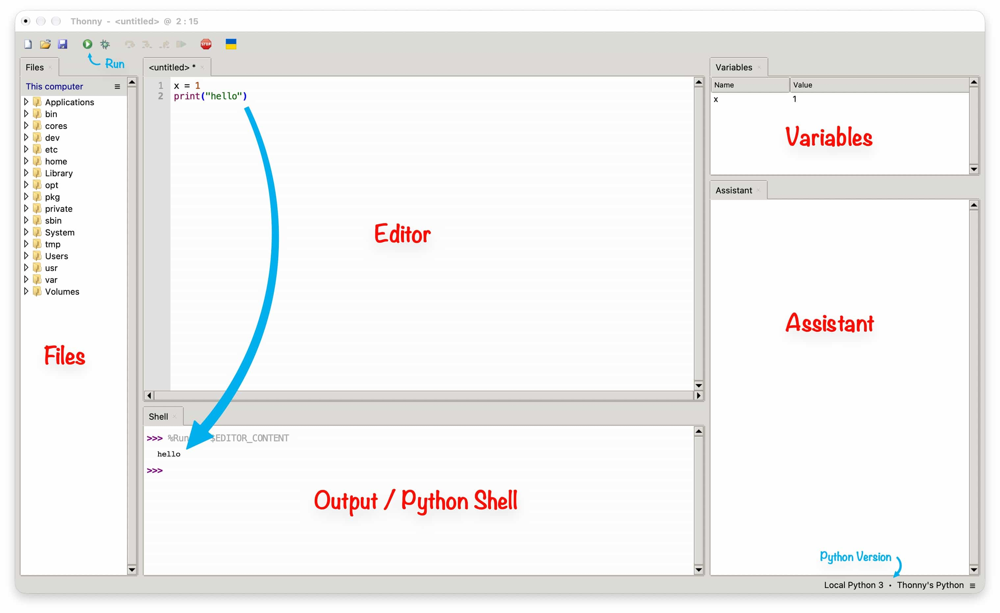
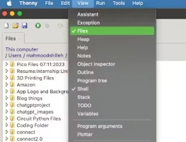
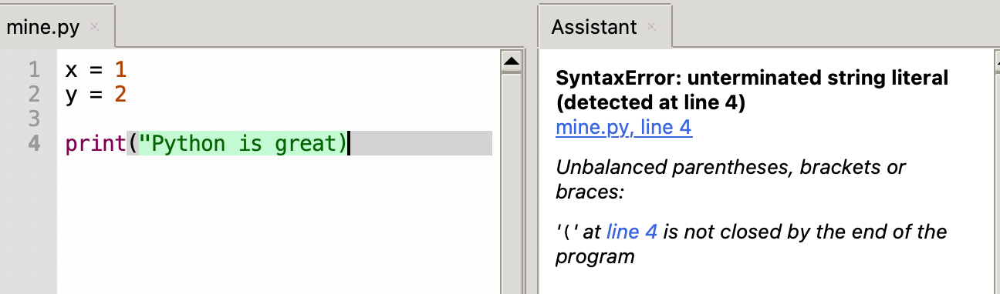
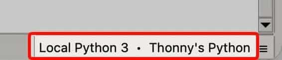
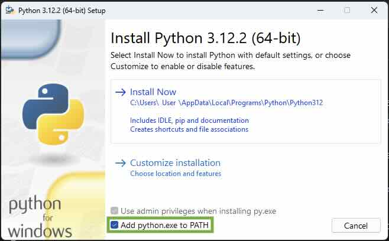

# The Tiger's Vest (Installing Python 3, Thonny, and the Shell)


<aside class="sidebar" markdown="1">
## About Python Versions

**Python 3** is the current major version of Python and is recommended for general use. New Python releases regularly introduce improvements, new features, performance enhancements, and bug fixes. When a new stable release becomes available, you can usually upgrade with confidence after confirming that any libraries you depend on are compatible.

Python version numbers have three parts, such as **3.14.7**: a **major** version, a **minor** version, and a **patch** version. The major version marks significant language changes, such as the transition from Python 2 to Python 3. The minor version adds features while maintaining compatibility within the major version. The patch version brings bug fixes, security updates, and small improvements.

Oh, and if I could give you a taste of how quickly Python evolves! New ideas are discussed by developers worldwide through Python’s enhancement-proposal process and community forums. Features are debated, refined, tested, and eventually welcomed into the language. Someone always has something to complain about. It is a remarkably lively machine, forever being polished while somehow continuing to run.
</aside>


## Install Python with an IDE

A command shell and the standard Python prompt are important tools to know. But we prefer a beginner-focused graphical place to write, run, inspect, and debug Python, so we will install **Thonny**. Thonny is a free, open-source Python IDE with many useful features for beginners.

What is an IDE and why do we need it? IDE stands for Integrated Development Environment and includes neat, beginner friendly features such as syntax highlighting (displays source code in different colors and fonts improving readability), highlighting syntax errors, auto completing code, and quick access to the system shell.

While Thonny or any other IDE is optional, they are quite useful for debugging.  There are other popular IDEs include Pycharm, VSCode and Cursor, but Thonny is lightweight and the quickest to get running out of the box, so is recommended. But if you already have your favorite IDE, go ahead and use that one instead and skip to the Optional section ["Installing Python to your OS"](#installing-python-to-your-os).

### Install Thonny (Best IDE for a beginner)

Most installers bundle Python, so you can install Thonny and Python together. 

* Download the installer for Windows or macOS from the [official Thonny website][7] and run it.

* On Linux, use your distribution package manager or the official installer.

```bash
# Debian / Ubuntu and related distributions
sudo apt install thonny

# Fedora
sudo dnf install thonny
```

Note, if you have an older computer that doesn't support the latest version of Thonny, you can try to install an [older version][6] (select a version from the Release List on the left, read the instruction, and click on Assets to download and install the older version). Or you can skip the IDE altogether and jump to: "Installing Python on your OS".

After installation, launch **Thonny** from your applications menu. Its main window contains an **Editor** for code. The bottom half is your Shell where you will see  outputs from your code. The **Shell** pane can also be used for immediate Python experiments.

* Use the Editor pane for longer code and programs you want to save.
* Use Python shell pane for viewing outputs. 
    * As well as experiments, tiny calculations, and checking an idea.  



Thonny runs in an isolated environment which means any packages we installed with `pip` do not appear in Thonny!

Installing a package is simplified with Thonny:

1. Open **Tools → Manage packages...**.
2. Search for package
3. Click the package name and click **Install** and wait for the success message.

### Best Features in Thonny

#### Built-in Python shell

At the bottom of the Thonny window is a build-in **Python shell** or **Python REPL** ( *Read-Eval-Print Loop*).

If you don't see it, simply click **View → Shell** and the Python shell appears at the bottom of the window.

In the Python shell, we can type in some Python code and Thonny evaluates it immediately.

```pycon
>>> 3000 + 500
3500
>>> tiger_vest = "buttoned"
>>> tiger_vest
'buttoned'
```

To reset the Python shell (clear all variables, stop execution, and start a fresh Python/MicroPython), simply hit the red Stop button (🛑) above the main code editor pane. Or simply type `exit()` in the Python shell.


```pycon
>>> tiger_vest
Traceback (most recent call last):
  File "<stdin>", line 1, in <module>
NameError: name 'tiger_vest' is not defined
```
 
#### Viewing Variables, Inspecting objects  

Now let's get to the cool part of using an IDE, viewing variables! Once your program has more than one value, you can view them by selecting **View → Variables**. Thonny displays the variables created by your program / Python shell commands and their current values. 

Type this in the editor pane and then press the Play button:

```python
tiger = "wearing a vest"
ice_gun_temperature = -273
rescue_ready = True
```

The Variables view shows all three names and values. This view is especially useful when you expected `rescue_ready` to be `True`, but it somehow became `False`, or when a planet is unexpectedly frozen by a ice gun.

If you need to know more about an object, you can always open the Object Inspector by selecting **View → Object inspector**. From there you can see all the object's attributes.

#### Auto-complete

Auto-complete is also available in Thonny. 

1. Enable Automatic "Type-Ahead" Suggestions (**recommended**)

    If you want the autocomplete window to pop up automatically without needing a shortcut:

    * Navigate to the top menu and select Tools > Options.
    * Click on the Editor tab.
    * Check the box that says "Automatically propose completions".*

2. Manual Autocomplete (Keyboard Shortcut)

    * Start typing your command, variable, or function.
    * Press `Ctrl + Space` (or Tab on some operating systems) to open the completions menu.

#### Files (Opening, Viewing, and Running)

You can manage files in Thonny using the File pane **View -> Files**. You will now see a list of files and folder on the left side. 



To set your working directory, navigate to the folder you want to use within the Files panel. You will see in Shell that the active directory gets set to this folder e.g. `%cd /Users/why/dev`.

You can then import modules from this directory (modules are any `.py` files that contain Python definitions). Or you can open a file and run it by pressing play. 

*By default, running a script also changes your directory.* You can turn this on and off **Tools -> Options -> Run & Debug** tab and check or uncheck "Change working directory to script directory on Run / Debug".


#### Find Syntax Errors in Your Code and Debugging

Most IDEs will highlight syntax errors. Missing a closing quote or parentheses is a common beginners' error and syntax highlighting makes this easy to spot. 

Turning on the assistant by selecting **View → Assistant** can help guide you in right direction to debug errors. 



The debugger is another way to track down bugs and lets you pause a program and move through a program step by step while inspecting the values along the way. 

Try this example to test the debugger.

Create and save this file in the editor pane as `ice_gun.py` by selecting `File > Save`:

```python
def set_ice_gun(bell):
    if bell == "pressed":
        return "on"
    return "off"

bell = "pressed"
ice_gun = set_ice_gun(bell)
print(ice_gun)
```

Start debugging it by clicking on the little critter next to the play icon. This starts the script but in debug mode.

The adjacent icons light up allow you to step through the program, in different ways (big steps or little steps). Try each of the step buttons and watch your variables change in the Variables pane as you step through the program. You can also resume the program by clicking the resume button that looks like a cross between pause and play (vertical bar followed by right pointing triangle).


#### Check what version of Python Thonny is using

Most IDEs will automatically begin to use the latest version of Python. However, 
when Thonny is installed, it already bring its own version of Python and manages its own packages. So to use this updated version along with any installed packages, we have to tell Thonny about it. 

You can see the current Python that Thonny is running at the **bottom right** of the window. 



```
Local Python • Thonny's Python
```

To update the Python Thonny uses, click on the `Local Python • Thonny's Python` text at the bottom right of the window and select select **Configure interpreter...** (the exact wording can vary slightly by release). 

For us beginners, Thonny’s Local Python 3 works great and is kept relatively up to date.

## Installing the latest Python to your OS (Optional)

??? tip "Optional: Installing the latest version of Python to our Operating System"
 

    THIS SECTION IS COMPLETELY OPTIONAL FOR THONNY USERS. 
    
    Thonny gives us all we need to get started, but for users that want to use another IDE or that are familiar with using the command shell, we can go one step further and install Python to our operating system.  

    To install the latest version of Python, first open a command shell: a text-based interface for talking directly to your operating system.

    - On **Microsoft Windows**, open the Start menu, type `cmd`, and press Enter.
    - On **macOS**, open **Terminal** from Spotlight or Launchpad.
    - On **Linux**, open your distribution’s Terminal application.

    Keep that command shell open, because we’ll need it if the Earth gets rescued from its plummet toward the sun.

    Now install the latest Python so you can follow the examples in the (Poignant) Guide and actually do things right now. Yes, things!

    - On **macOS**, download Python from the [Python website][1] or install it with Homebrew:

    ```bash
    brew install python
    ```

    - On **Debian** or **Ubuntu**:

    ```bash
    sudo apt install python3
    ```

    - On **Fedora**:

    ```bash
    sudo dnf install python3
    ```

    - On **Microsoft Windows**, download from [Python website][1] (during setup, make sure to select **Add python.exe to PATH**).

    

    - On a **Chromebook**, follow the [Chromebook setup tutorial][2], then return here.

    ### Test the Install Worked

    Open a command shell and run:

    ```bash
    python3 --version
    ```

    Or, on many Windows systems:

    ```bash
    python --version
    ```

    If Python is installed properly, you’ll see version information for the latest version of Python:

    ```text
    Python 3.xx.x
    ```

    If neither command works, try closing and reopening Command Prompt. You can also rerun the installer and double check the PATH option.

## Virtual Environment (Optional)

??? tip "Optional: Setup a Virtual Environment"
    Software incompatibility is a scourge to programmers: a newer library can break older project code. A Python virtual environment gives each project its own installed packages and versions. This is very useful when you have multiple projects each with different version of python and using different packages.

    Think of it as project having a private, clear Hello Kitty backpack. You pack only the tools and versions that project needs, keeping them from getting mixed up with other projects or the system Python.

    For this book we won't need a Virtual Environment, but keep this section in mind when you go on to create more Python projects.

    ### Creating you Virtual Environment 

    1. In Thonny, we can do this by selecting **Run ➔ Configure interpreter...** and clicking "New virtual environment." 

    You'll be prompted to select an empty directory for your new project's local environment. Navigate to where you want to keep your project files (e.g., your Documents folder) and create a New Folder for your project (e.g., poignant_code). Choose that newly created folder. You will see your check your virtual environment is active at the bottom right of your Thonny window (it will change from Thonny's Python to a custom path).

    2. In command shell, change to your project folder, and create an virtual environment named `.venv`:

    ```bash
    python3 -m venv .venv
    # Or Windows
    python -m venv .venv
    ```

    To activate it:

    ```bash
    source .venv/bin/activate
    # Or Windows
    .venv\Scripts\activate
    ```

    A prefix such as `(.venv)` should appear in the command shell prompt.

    Remember, you'll need to activate your virtual environment to use it for this project whenever you open a fresh command shell.

    ### Customizing your Virtual Environment

    Now that your virtual environment created, you can change the Python version *just* for the virtual environment and install packages that will available *only* in your virtual environment.

    Check the Python's location inside the virtual environment like so:

    * Thonny: **Tools -> Open system shell..** or simply check the bottom right of the window
    * Windows 
        * cmd: `where python`
        * PowerShell: `(Get-Command python).Path`
    * macOS / Linux terminal: `which python3`

    The reported Python path is now inside of your virtual environment. Changing this to another version of Python will only effect the virtual environment. 
    
    You can also install specific version of packages here. Packages installed inside the virtual environment will not be available to the rest of your system.

## Install Packages

Python packages are collections of **reusable code modules** that extend Python's core capabilities. Instead of writing complex tools like data visualizers, web scrapers, or machine learning algorithms from scratch, you can download official, community-made packages (like `pandas`, `matplotlib`, or `pygame`) from the Python Package Index (PyPI) and use them directly in your programs!

The **Python Package Index (PyPI) **is the official public repository for third-party Python software. 

*`pip` is the command-line package installer used to download and manage those packages. 
* Thonny IDE also integrates directly with PyPI to let you search for, install, and manage third-party Python packages.

This book uses the `requests` package in Chapter 6 for HTTP requests. Let's go ahead and install it.

**1. Install `requests` package in your Thonny IDE (best for beginners using Thonny)**

Installing a package is simplified with Thonny:

1. Open **Tools → Manage packages...**.
2. Search for package
3. Click the package name and click **Install** and wait for the success message.

Let's search for requests package, click on the first result *requests* and install the latest stable 
version. 

After that, `requests` is available to programs run in Thonny.

If you an IDE other than Thonny, you will likely need to install the `requests` package the traditional way using `pip`. See "Install Packages" in the next optional section for steps to install packages using `pip`.
   
**2. Install `requests` package using `pip` (for people using other IDEs or command shell)**
To install `requests` with pip, first check that `pip` exists. 

In your command shell type:

```bash
python3 -m pip --version
# Or, on many Windows systems:
python -m pip --version
```

If the command fails, you maybe need to install `pip`. Follow the official instructions to [install pip][3]. 

Now install `requests`: 

```bash
python3 -m pip install requests
# Or: python -m pip install requests
```

**Test our packages**

To test our packages, we first open Python shell 

If you are using Thonny or another IDE, you can use the built-in Python shell at the bottom of the window or a terminal. (In Thonny, select **View → Shell** if its not there).

??? info "For terminal or command shell users, to open Python Standard Shell run:"

    ```bash
    python3
    # or on many windows systems
    python
    ```

**You should see:**
```pycon
>>>
```

In the Python shell, run these commands to confirm the `requests` package was installed:

```pycon
>>> import requests
```

??? warning "What to do if this command fails?"
    If the `import requests` fails, here are some step to debug what went wrong. 
    
    * If you are using Thonny, make sure the package was installed through Thonny's package manager and not `pip`. 
    * If you are using a virtual environment, double check that it is active. 
    * If none of these help, you'll need to go through the steps in **Install Packages** again more carefully to make sure `request` package got properly installed for the Python environment you are using. 

Now, let's test the `requests` package and find out where it was installed (exact path will vary by your setup).

```pycon
>>> import requests
>>> response = requests.get("https://github.com", timeout=10)
>>> print(response.status_code)
200
>>> print(requests.__file__)
...site-packages/requests/__init__.py
```

You've successfully installed the `request` package.

## Understanding the Python shell


Python comes with a very, very, very extremely helpful tool called the **Python shell** or Python REPL. REPL means *Read-Eval-Print Loop*. 

Let's start by opening a Python shell.

If you are using Thonny or another IDE, you can use the built-in Python shell at the bottom of the window or a terminal. (In Thonny, select **View → Shell** if its not there).

??? info "For terminal or command shell users, to open Python Standard Shell run:"

    ```bash
    python3
    # or on many windows systems
    python
    ```

You will see:

```pycon
>>>
```

Python is saying, “I’m listening. Type something.” The Python shell makes a splendid calculator:

```pycon
>>> ((220.00 + 34.15) * 1.08) / 12
22.8735

>>> int("1011010", 2)
90
```

This prompt also lets you enter Python code and run it immediately by pressing Enter. 

```pycon
>>> from datetime import datetime
>>> (datetime(2026, 3, 14, 15, 14) - datetime(2026, 3, 14, 13, 59)).total_seconds()
4500.0
```

The first example does arithmetic. The second converts a binary string to a decimal number. The third computes the number of seconds between 1:59 PM and 3:14 PM on Pi Day, March 14, 2026: exactly 4,500 seconds.

And this command confirms the current folder:
```py
import os
os.getcwd()
```

!!! tip "Tip: Copy and paste examples into a Python shell"

    Use the copy icon (:octicons-copy-24:) in the top-right corner of a code block. Paste into a command shell with Cmd+V on macOS or Ctrl+V on Linux and Windows, then press Enter. In Thonny, paste directly into the Shell or editor with the same shortcuts.

Try assigning a value:

```pycon
>>> bell = "pressed"
>>> bell
'pressed'
```

Expressions are evaluated and their results displayed. For code spanning multiple lines, the prompt becomes either `...` (or just indented empty space in the case of Thronny's Shell):

```pycon
>>> bell = "pressed"
>>> if bell == "pressed":
...     ice_gun = "on"
... else:
...     ice_gun = "off"
...
>>> ice_gun
'on'
```

The continuation prompt appears after a statement requiring more lines, such as an `if` statement, function definition, loop, or unfinished expression:

```pycon
>>> total = (
...     220.00
...     + 34.15
... )
>>> total
254.15
```

To leave the Python shell, enter `exit()` followed by Enter. On macOS and Linux, Ctrl+D also exits; on Windows Command Prompt, Ctrl+Z. Note that in Thronny, you cannot leave the shell this way, but you can hide it by deselecting **View -> Shell** 

### Auto-Complete

In modern Python shells, pressing Tab can complete names or show possible attributes. For example, type this in your Python shell:

```pycon
>>> "".rep
```

Then press Tab to complete or choose `replace`. Completion helps you explore an unfamiliar object, but it is not a substitute for reading documentation with help.

Note, auto-complete is also available in Thonny's editor pane. If it's not switched on, simply hit `ctrl + spacebar` and you'll see the possible methods listed plus a tooltip with a helpful description.


### The Built-In Oracle: `help()`

(Python's Own 411 or 555-1212 or Yes, Operator, Get Belgrade on the Line—I'll Be Right Here—Just Plain Hammering The Zero Key Until Someone Picks Up…)

Once you know a name, ask Python what it means. Python’s built-in `help()` displays documentation for functions, classes, methods, and modules:

```pycon
>>> help(zip)
>>> help(list)
>>> help(str.replace)
>>> import itertools
>>> help(itertools)
```

In the standard Python shell, `help()` may open an interactive help viewer; press `q` when you have finished reading. In Thonny, the Shell will display the documentation in its interface.

Behind `help()` are docstrings: documentation strings that authors place immediately inside a module, class, or function. Write useful docstrings in your own code so your future self can ask for help, too:

```python
def time_parts():
    """Return a list containing hours, minutes, seconds, and fractions of a second."""
```

For a longer example:

```python
class CatFeeder:
    def __init__(self, food, num_of_cats=1, tiger=False):
        """Initialize a feeder with food and cat specifications.

        Args:
            food: The food to distribute, such as ``"fish"`` or ``"kibble"``.
            num_of_cats: The number of cats to feed.
            tiger: Whether one of the cats is a tiger. Proceed carefully.
        """
```

Save this code in `catfeeder.py`, import it, and ask for help:

```pycon
>>> import catfeeder
>>> help(catfeeder)
>>> help(catfeeder.CatFeeder)
```

Well then. Your hands are in it all now. Welcome to Python.


[1]: https://www.python.org/downloads/
[2]: https://tutorial.djangogirls.org/en/chromebook_setup/
[3]: https://pip.pypa.io/en/stable/installation/
[6]: https://github.com/thonny/thonny/releases
[7]: https://thonny.org/
